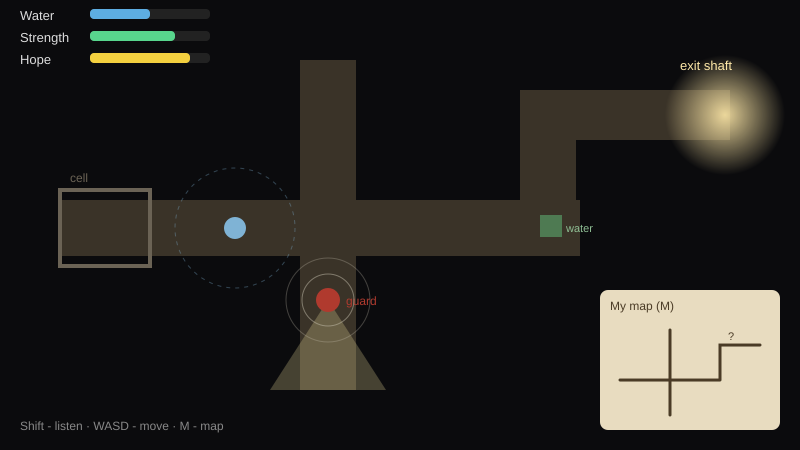
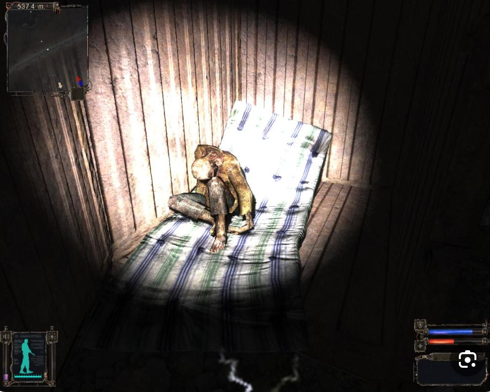

# אור במנהרה (Light in the Tunnel)

**אין נשק ואין אור. יש רק סבלנות, זיכרון ותקווה.**

## על המשחק

משחק התגנבות בהשראת הסיפור של אבינתן אור, שנחטף מפסטיבל נובה ב-7 באוקטובר והוחזק במנהרות של חמאס עד ששוחרר.

אתם מתעוררים בתא במנהרה, כמעט בחושך מוחלט, וצריכים למצוא את הדרך החוצה. אין קרבות ואין נשק. מקשיבים לצעדים של השומרים, מחכים לרגע הנכון, מציירים לבד את המפה של המנהרות ושומרים על המים והאוכל. מד התקווה, שמתמלא מזיכרונות מהבית ומהמשפחה, הוא מה שנותן כוח להמשיך.

הגרפיקה תלת-ממדית, עם מצלמה מאחורי הכתף ותאורה חשוכה וכבדה: כמעט הכול שחור, ורק אלומה של פנס או סדק של אור חושפים לרגע את מה שמסביב. כשהשומר חושד מופיע מעליו "?!", וזה הרגע להתחבא.

המשחק עוסק בסיפור אמיתי וכואב, ולכן הוא לא מציג אלימות. הדגש הוא על חוסן ועל תקווה.

## מסמך עיצוב

[הרכיבים הרשמיים של המשחק וסקירת משחקים קיימים](formal-elements.md)

## חברי הצוות

* דוד בלוך ([davidbloch18](https://github.com/davidbloch18))
* [להשלים: שם מלא] ([omrisabag2001](https://github.com/omrisabag2001))

