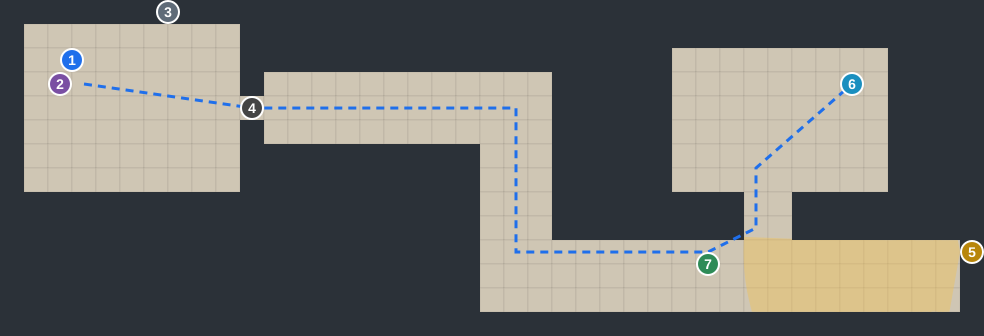

<div dir="rtl" lang="he">

# אור במנהרה: תסריט, מערכות ושלבים

מסמך עבודה למטלה 3. כאן מרוכז כל מה שסיכמנו על הסיפור, על המערכות במשחק ועל ארבעת השלבים.

---

## מה השתנה לעומת מסמך העיצוב

| נושא | במסמך העיצוב | עכשיו |
|---|---|---|
| חפירה | לא חופרים, מתמצאים במנהרות קיימות | **הבריחה היא חפירה** דרך שקי חול, כמו בסיפור האמיתי |
| פנס | נמצא באמצע המשחק | **בונים אותו לבד** מכבלים שבורים ומנורה |
| היתפסות | חוזרים לתא ומאבדים תקווה | **מד חיים.** מכות, ובסוף מוות. פירוט בהמשך |
| מפה | השחקן מצייר אותה | **יומן** שנמצא בתא, עם שלושה חלקים |
| תקווה | עולה מזיכרונות | עולה גם **מפסוקים ותפילות**, עם חוקים שמגבילים אותה |

---

## על מה המשחק מבוסס

מה שידוע בפומבי על הסיפור של אבינתן אור, ונכנס למשחק:

- היה לבד לגמרי במנהרות, 738 ימים, ולא פגש אף חטוף אחר
- מהנדס. שרטט תוכנית בריחה
- בנה מקור אור מכבלים שבורים
- חפר בידיים דרך שקי חול, לפי חלק מהדיווחים יותר מעשרה מטרים
- כתב "חטוף" על שק חול לבן
- פרץ את השכבה החיצונית של המנהרה וראה את הכוכבים, ואז נתפס והוכה
- איבד בין שלושים לארבעים אחוז ממשקל הגוף
- שוחרר בעסקה באוקטובר 2025

הדיווחים לא אחידים בכל הפרטים, ולכן צריך לבדוק במקורות לפני שמשתמשים בפרט מסוים.

**חשוב:** כמו שכתבנו בסקר השוק, לא מפרסמים את המשחק עם השם שלו, עם פרטים מהסיפור שלו או עם סרטון שלו בלי הסכמה שלו.

---

## הקשר לסקר השוק

לפי סקר השוק, קהל היעד הוא שחקני מחשב בגילאי 18 עד 40 שאוהבים משחקים קצרים עם סיפור ומשחקי התגנבות שקטים. המשחק דורש סבלנות יותר מתגובות מהירות. קהל נוסף הוא הקהל הישראלי והיהודי בעולם, שהסיפור נוגע בו אישית. מזה נגזרו חמישה עקרונות לתכנון השלבים:

1. **הקושי עולה דרך חשיבה, זיכרון וסבלנות, לא דרך מהירות תגובה.** בכל שלב יש חלונות זמן ברורים, וחוק החלון מבטיח שתמיד יש מספיק זמן.
2. **אין קרבות ואין אלימות גרפית.** מכות ומוות מועברים בחושך ובצליל, כמו שכתבנו במסמך העיצוב.
3. **התקווה והסיפור במרכז.** זה מה שמבדיל אותנו ממשחקי האימה והבריחה שסקרנו, שבהם המשאב המרכזי רק יורד.
4. **משחק קצר.** כל שלב אורך חמש עד עשר דקות.
5. **רגישות.** הסיפור מוצג בכבוד, בלי להפוך את השבי לאקשן. לכל שלב מצוין בהמשך למה הוא מתאים לקהל.

---

## היומן: הלב של המשחק

השחקן **מוצא** את היומן מתחת למזרן בתא. כתבו בו מי שהיו בתא לפניו, והוא ממשיך לכתוב בו בעצמו. זה לא סותר את הסיפור האמיתי: הוא לא פגש אותם, הוא רק מוצא את מה שנשאר.

### שלושת החלקים

| חלק | מה יש בו | מה זה עושה במשחק |
|---|---|---|
| **הבריחה** | סקיצות, מפה, תוכנית, מה שהוא רואה | עוזר לתכנן ולהתמצא |
| **התקווה** | פסוקים, תפילות, זיכרונות מהמשפחה | מעלה את מד התקווה |
| **הקודמים** | מה שכתבו מי שהיו בתא לפניו | רמזים, בעיקר בהתחלה |

### איך היומן מלמד

- **כותרות** בכל חלק אומרות לשחקן מה לחפש ומה לעשות. למשל: "מי שומר עליך?", "ממה אתה שואב כוח?", "צריך אור".
- **ציור ביומן, ואז הדבר האמיתי מולו, ואז השחקן מבין לבד את החוק.** למשל: ציור של מצלמה, ואז מצלמה אמיתית במסדרון, ואז הבנה שאסור לעבור כשהיא מסתכלת.
- **ככל שמתקדמים, היומן עוזר פחות.** בשלב הלימוד כמעט הכול כתוב. בשלב הקשה השחקן נשען רק על מה שרשם בעצמו.
- **הדף האחרון של הקודמים**, באמצע השלב הקשה: "אם אתה קורא את זה, תמשיך לחפור מהמקום שבו אני הפסקתי."

---

## מערכת התקווה

### התקווה בגוף: ארבעה מצבים

| מצב | טווח | תנועה | ראייה | שמיעה | ידיים |
|---|---|---|---|---|---|
| **אמונה** | 75 עד 100 | רגילה ויציבה | טווח רחב, קצת צבע בתמונה | נשימה רגועה, ההקשבה שומעת רחוק | חפירה מהירה, כתב יד יציב |
| **מחזיק מעמד** | 50 עד 75 | קצת איטית | תמונה אפורה יותר | נשימה רגילה | חפירה רגילה |
| **שבור** | 25 עד 50 | איטית מאוד | החושך סוגר מהצדדים | דופק לב, ההקשבה שומעת רק קרוב | ידיים רועדות, חפירה איטית |
| **ייאוש** | 0 עד 25 | כמעט זוחל | כמעט שחור, רק עיגול קטן | דופק חזק שמסתיר צעדים של שומרים | אי אפשר לחפור |

**הרעיון:** בלי תקווה אי אפשר לברוח. השחקן מבין את זה מעצמו.

### חמשת החוקים שמגבילים את התקווה

1. **מתפללים רק במקום שקט.** מקום שקט הוא מקום קבוע במפה שאף מצלמה לא רואה ואין שומר במרחק חמש משבצות. המקומות השקטים: המזרן בתא, מקומות שהקודמים סימנו ביומן ("כאן שקט"), ומתחת לסדק אור בשלבים מסוימים. ככל שהשלב קשה יותר, יש פחות מקומות כאלה.
2. **תפילה לוקחת זמן.** לוחצים ממושכות ולא זזים. אם שומר מתקרב באמצע, התפילה נקטעת ומקבלים רק חצי.
3. **פסוק נחלש כשחוזרים עליו** באותו שלב: בפעם הראשונה הוא נותן הכול, בפעם השנייה חצי, ובפעם השלישית כלום ("המילים כבר לא נוגעות. צריך משהו חדש").
4. **ממתינים בין תפילות.** ההמתנה מתארכת משלב לשלב.
5. **תקרה שיורדת.** בכל שלב יש גבול עליון לתקווה, כי הגוף נחלש.

### שמע ישראל: רשת הביטחון

- פעם אחת בכל שלב, כשהתקווה מגיעה לאפס, השחקן אומר מעצמו "שמע ישראל", והתקווה חוזרת ל-25.
- אם התקווה מגיעה לאפס בפעם השנייה באותו שלב, זה נחשב היתפסות.

### הפסוקים

| פסוק | מקור | מתי מקבלים |
|---|---|---|
| שמע ישראל ה' אלוהינו ה' אחד | דברים ו, ד | מההתחלה. רשת ביטחון |
| ויש תקווה לאחריתך נאום ה' ושבו בנים לגבולם | ירמיהו לא, טז | העמוד הראשון של חלק התקווה |
| קווה אל ה' חזק ויאמץ ליבך וקווה אל ה' | תהילים כז, יד | שלב הלימוד |
| גם כי אלך בגיא צלמוות לא אירא רע כי אתה עמדי | תהילים כג, ד | השלב הקל, ליד סימני הספירה על הקיר |
| הנה לא ינום ולא יישן שומר ישראל | תהילים קכא, ד | השלב הקל, כשלומדים את השומרים |
| אשא עיניי אל ההרים מאין יבוא עזרי, עזרי מעם ה' עושה שמיים וארץ | תהילים קכא, א עד ב | השלב הבינוני, אחרי שהשומרים אומרים שבבית שכחו אותו |
| הזורעים בדמעה ברינה יקצורו | תהילים קכו, ה | השלב הבינוני, אחרי הלילה הראשון של חפירה |
| מן המיצר קראתי יה, ענני במרחב יה | תהילים קיח, ה | רק ברגע האחרון, כשהאדמה נפתחת ורואים את הכוכבים |

צריך לבדוק את הנוסח המדויק מול תנ"ך לפני שמכניסים למשחק.

### מה מעלה ומה מוריד

| מעלה | כמה | הגבלה |
|---|---|---|
| פסוק, פעם ראשונה | 20 | רק במקום שקט |
| פסוק, פעם שנייה | 10 | |
| זיכרון של המשפחה | 15 | כל זיכרון פעם אחת |
| דף חדש של הקודמים | 5 | כל דף פעם אחת |
| כל מטר שנחפר | 3 | |
| בניית האור | 25 | פעם אחת |
| כתיבת "חטוף" על השק | 30 | פעם אחת, לא חובה |
| אוכל ומים | קצת | |

| מוריד | כמה |
|---|---|
| הזמן עובר | לפי השלב, ראו טבלה בהמשך |
| כמעט נתפס | 10 |
| השומרים צוחקים או אומרים שבבית שכחו אותו | 20 |
| נתפס ומוכה | 15 |
| פיצוץ קרוב | 5 |
| רעב, כשמד האוכל מתחת לרבע | ירידת הזמן מוכפלת |

---

## חוק החיים והמוות

| מצב | מה קורה |
|---|---|
| תחילת המשחק | 100 חיים |
| נתפס | מוכה: מינוס 25 חיים ומינוס 15 תקווה. מתחיל את אותו שלב מההתחלה |
| החיים הגיעו לאפס | יריה, מסך שחור. חוזר לשלב הקודם עם 100 חיים |
| עבר שלב | פלוס 25 חיים, עד 100 לכל היותר |
| שלב הלימוד | אין חיים ואין מוות. מי שנתפס נדחף חזרה לתא ומקבל אזהרה ביומן |
| הגיע לאפס בשלב הקל | חוזר לשלב הלימוד |

**איך מראים מכות ומוות בלי אלימות:** מסך שחור וצלילים. אחרי מכות השחקן מתעורר בתא עם תמונה מטושטשת.

**דוגמה למסלול של שחקן:**

```
שלב קל:     100 → נתפס → 75 → עבר
שלב בינוני:  100 → נתפס → 75 → נתפס → 50 → עבר
שלב קשה:    75 → נתפס → 50 → נתפס → 25 → נתפס → 0
            יריה. חוזר לשלב הבינוני עם 100
```

---

## סימנים בתרשימים

כל תו בתרשים הוא משבצת אחת במשחק. התרשימים נקראים משמאל לימין: מספרי העמודות למעלה, ומספרי השורות בצד. מיקום נכתב כך: (עמודה, שורה).

| סימן | משמעות |
|---|---|
| `#` | קיר |
| `.` | רצפה |
| `S` | המזרן בתא: נקודת ההתחלה, מקום שקט, והיומן מתחתיו |
| `D` | דלת התא |
| `K` | שבר בטון חד, לחיתוך החבל |
| `Q` | מקום שקט |
| `H` | מסתור |
| `C` | מצלמה |
| `V` | מצלמה שנייה |
| `W` | מים |
| `F` | אוכל |
| `R` `r` | חדר השומרים |
| `s` | המחסן |
| `B` | שקי החול |
| `T` | סימני ספירה חרוטים בקיר |
| `e` | חדר החשמל |
| `d` | דלת חדר החשמל |
| `g` | המקום שבו שומר יושב |
| `1` `2` | חלקי כבל |
| `L` | מנורה שבורה, ממנה לוקחים נורה |
| `x` | הריסות. עוברים בחצי מהירות |
| `=` | מנהרה שכבר נחפרה |
| `~` | מנהרה שנשאר לחפור |
| `Y` | שורש העץ, המטר האחרון |
| `O` | היציאה לשמיים |

### מספרים כלליים

| מה | ערך |
|---|---|
| מהירות הליכה רגילה | שלוש משבצות בשנייה |
| מהירות בשלב הלימוד, כי הוא פצוע | שתי משבצות בשנייה |
| רצפת מהירות, האיטית ביותר | משבצת וחצי בשנייה |
| חפירה של מטר אחד, שהוא משבצת אחת | שש שניות. במצב "שבור": תשע שניות |
| מרחק מקום שקט משומר | לפחות חמש משבצות |

---

## התסריט

### פתיחה

מסך שחור. מוזיקה של מסיבה מתנגנת רחוק, מתעוותת ונעלמת. נשאר קול נשימה כבדה. כיתוב: "שבעה באוקטובר". המסך נפתח לאט, מטושטש, והקולות עמומים כמו מתחת למים.

---

### שלב ראשון: היום הראשון (שלב לימוד)

**איפה:** התא, מסדרון מחוץ לדלת, מסדרון תחתון, וחדר מחסן שבו הבקבוק.
**מה השחקן מרגיש:** בלבול, כאב, פחד, ובסוף ניצוץ ראשון של תקווה.

**מצב התחלה:** תקווה 30, אוכל 50, מים 50. אין חיים ואין מוות. אין חפצים. פסוק ידוע: שמע ישראל.

**תרשים:**



1 המזרן, 2 הפתק עם שמות המשפחה, 3 סימני הספירה, 4 דלת התא, 5 המצלמה והשטח שהיא רואה, 6 בקבוק המים, 7 נקודת ההמתנה. הקו המקווקו הוא המסלול.

**ניצחון בשלב:** חוזרים למזרן עם הבקבוק.

**התאמה לסקר השוק:** אין סכנת מוות, והשחקן לומד בקצב שלו. הפתיחה רגשית ומציגה את הסיפור, וזה מה שהקהל שלנו מחפש.

**רגע 1, ההתעוררות:** שוכב על מזרן דק בתא קטן מבטון, הידיים קשורות מאחורי הגב. התמונה מתחדדת במשך כעשר שניות. הוא זז לאט מאוד כי כל הגוף כואב. מחוץ לדלת נשמעים צחוק וקולות של שומרים חמושים, שלא נראים. על הקירות ציורים וכתובות.

**רגע 2, להשתחרר:** בפינת התא בולט שבר בטון חד. השחקן נצמד אליו ולוחץ ממושכות על מקש הפעולה, פס מתמלא והחבל נקרע. *לומד: לזוז, ולהשתמש במקש הפעולה.*

**רגע 3, מציאת היומן:** פינה של משהו בולטת מתחת למזרן. יומן ישן ומרופט. בעמוד הראשון, בכתב יד של מישהו אחר: "אם מצאת את זה, אתה לא הראשון. תקרא לאט." הוא מעביר דפים ומגלה את שלושת החלקים. *מרגיש: סקרנות, ותחושה שהוא לא לגמרי לבד.*

**רגע 4, התקווה הראשונה:** בחלק התקווה יש עמוד עם הכותרת "ממה אתה שואב כוח?", וזיכרון: משפחה סביב שולחן שבת. הוא מקבל את הפסוק "קווה אל ה'". התקווה עולה, החושך בצדדים נפתח והדופק נרגע. *לומד: מה התקווה עושה.*

**רגע 5, המצלמה:** בחלק הבריחה יש כותרת "מי שומר עליך?" וציור של מצלמה עם חץ. הוא מסתכל דרך סדק בדלת ורואה מצלמה אמיתית בתקרת המסדרון: שלוש שניות לצד אחד, עצירה, שלוש שניות לצד השני. על הרצפה נראה אור חלש במקום שהמצלמה מסתכלת. *לומד: איפה שהאור נופל, רואים אותך.*

**רגע 6, ההקשבה:** בחלק הקודמים כתוב "תקשיב לפני שאתה זז. הם תמיד חוזרים." מקש ההקשבה מראה גלי קול. שומר עובר במסדרון כל עשרים שניות. *לומד: לשמוע את הסכנה לפני שרואים אותה.*

**רגע 7, המשימה הראשונה:** בקבוק מים על מגש במסדרון, שני צעדים מהדלת, והדלת לא סגורה עד הסוף. מחכים שהמצלמה תפנה לצד השני ושהשומר יתרחק, יוצאים, לוקחים את הבקבוק וחוזרים. אם המצלמה רואה אותו, נשמעת צעקה והוא נדחף לתא. ביומן נכתב: "כמעט. בפעם הבאה זה לא ייגמר ככה."

**סיום:** הלילה יורד. הוא רושם ביומן סקיצה ראשונה של התא והמסדרון, ו"יום 1".

---

### שלב שני: השבועות הראשונים (שלב קל)

**כיתוב:** "יום 23".
**איפה:** התא, המסדרון, חדר השומרים, המחסן, ופנייה עם קיר של שקי חול.
**מה השחקן מרגיש:** מתח אמיתי בפעם הראשונה.

**מה השתנה:** אוכל ומים נמוכים יותר. מכאן יש חיים ומוות.

**מצב התחלה:** תקווה 50, אוכל 30, מים 30. החיים כפי שהגיע, 100 בפעם הראשונה. פסוקים ידועים: שמע ישראל, קווה אל ה'.

**תרשים:**

<pre dir="ltr">
             1111111111222222
   01234567890123456789012345
 0 ##########################
 1 #......###########rrrrrr##
 2 #.S....####C######rrrrrr##
 3 #......D.H........rrrrrr##
 4 #......####.##############
 5 #......####.##############
 6 ###########.H#############
 7 ##########BQ.....#########
 8 ###############T.#########
 9 #############ssssss#######
10 #############sFWssQ#######
11 #############ssssss#######
12 ##########################
</pre>

**מיקומים:**
- **שומר אחד:** יוצא מחדר השומרים ב-(18,3), הולך מערבה עד הצומת ב-(11,3), דרומה עד (11,7), מזרחה עד (16,7), ודרומה עד המחסן ב-(16,9). עוצר חמש שניות בכל קצה. סיבוב מלא: שלושים שניות.
- **מצלמה** `C` ב-(11,2), מעל הצומת. סורקת את המסדרון מעמודה 8 עד 14, ואת תחילת המעבר הדרומי.
- **מסתורים:** גומחה `H` ב-(9,3) ליד התא, וארגזים `H` ב-(12,6).
- **שקי החול** `B` ב-(10,7). **סימני הספירה** `T` ב-(15,8).
- **מחסן:** אוכל `F` ב-(14,10), מים `W` ב-(15,10).
- **שלושה מקומות שקטים:** המזרן, הפינה ליד השקים ב-(11,7), שקטה רק כשהשומר בחדר השומרים, ופינת המחסן ב-(18,10).

**ניצחון בשלב:** נגע בשקי החול, וחזר למזרן עם שני פריטי אוכל ובקבוק מים.

**התאמה לסקר השוק:** שומר אחד עם דפוס קבוע, שלומדים בהקשבה. זה אתגר של סבלנות ולא של מהירות, ויש מספיק מסתורים כדי לטעות וללמוד.

**המשימות, לפי הכותרות ביומן:**
- **"מתי הוא עובר?"**: מקשיבים לשומר שני סיבובים, וביומן נרשם "עובר כל שלושים שניות, עוצר בקצוות".
- **"לא לגווע"**: מביאים מהמחסן שני פריטי אוכל ובקבוק מים, וחוזרים בלי להיראות.
- **"קיר רך"**: בחלק הקודמים כתוב "השקים ליד הפנייה. החול שם רך." נוגעים בשקים, וביומן מופיעה סקיצה.

**רגע של תקווה:** ליד הפנייה יש סימני ספירה חרוטים בקיר. עצב, ונחישות. הוא מקבל את "גם כי אלך בגיא צלמוות", ובלימוד השומר את "הנה לא ינום ולא יישן שומר ישראל".

**סיום:** חוזר לתא עם האוכל. ביומן: "יש מקום לחפור. אבל בחושך אי אפשר." מופיעה כותרת חדשה: "צריך אור", עם ציור של כבל.

---

### שלב שלישי: אחרי חודשים (שלב בינוני)

**כיתוב:** "יום 140".
**איפה:** מפה גדולה יותר. נוספים חדר חשמל ומסדרון שקרס בחלקו.
**מה השחקן מרגיש:** עייפות, וייאוש שמתחלף בתוכנית.

**מצב התחלה:** תקווה 40, אוכל 20, מים 20. אין אור, ואף מטר לא נחפר. פסוקים ידועים: כל מה שהיה בשלבים הקודמים.

**תרשים:** אותה מפה כמו בשלב הקל, שתי שורות נמוך יותר, ונוספו לה חדר החשמל והמסדרון שקרס.

<pre dir="ltr">
             111111111122222222223333
   0123456789012345678901234567890123
 0 ##################################
 1 ############1eee##################
 2 ############eeeg##################
 3 #......######d####rrrLrr##########
 4 #.S....####C#.####rrrrrr##########
 5 #......D.H........rrrrrr##########
 6 #......####.######################
 7 #......####.######################
 8 ###########.H###########V#########
 9 ##########B..........xxx......2###
10 ###############T.#################
11 #############ssssss###############
12 #############sFWssQ###############
13 #############ssssss###############
14 ##################################
15 ##################################
</pre>

**מיקומים:**
- **חדר החשמל** `e` ב-(12–15, 1–2), והדלת שלו `d` ב-(13,3). **כבל ראשון** `1` ב-(12,1).
- **מנורה שבורה** `L` ב-(21,3), בחדר השומרים. ממנה לוקחים את הנורה, רק כשהשומר הראשון בסיבוב.
- **המסדרון שקרס:** מ-(17,9) עד (30,9). הריסות `x` ב-(21–23, 9), שעוברים בהן בחצי מהירות. **כבל שני** `2` ב-(30,9).
- **מצלמה שנייה** `V` ב-(24,8). סורקת את המסדרון שקרס מעמודה 20 עד 28.
- **שומר ראשון:** אותו מסלול כמו בשלב הקל, שתי שורות נמוך יותר.
- **שומר שני:** יושב `g` בחדר החשמל ב-(15,2) עשרים שניות, ואז הולך עד הפנייה ב-(11,9) וחוזר, עוד עשרים וחמש שניות. הסיבובים של שני השומרים לא מתואמים.
- **שני מקומות שקטים:** המזרן, ופינת המחסן ב-(18,12).
- **הפצצה:** בערך כל תשעים שניות. החשמל נופל לחמש שניות, ושתי המצלמות כבות.

**ניצחון בשלב:** בנה את האור, וחפר שלושה מטרים מערבה משקי החול.

**התאמה לסקר השוק:** כאן השחקן צריך לתכנן מסלול של כמה צעדים ולבחור את הרגע הנכון. זה עדיין משחק של חשיבה, לא של זריזות. רגע השבירה והתקווה מחזק את הסיפור.

**מה השתנה:**
- הוא חלש מאוד. האוכל נגמר מהר יותר.
- **שני שומרים** עם סיבובים לא מתואמים, ו**שתי מצלמות**.
- **הפצצות:** פיצוץ רחוק, האדמה רועדת, והחשמל נופל לחמש שניות, כך שהמצלמות כבות. זו הזדמנות, לא חובה.

**המשימות:**
- **"צריך אור"**: לאסוף שלושה חלקים. כבל בחדר החשמל, ליד שומר שיושב. כבל במסדרון שקרס, בדרך צרה עם מצלמה. נורה ממנורה שבורה בחדר השומרים, שנכנסים אליו רק כשהם בסיבוב. כשיש את שלושתם, ביומן מופיע שרטוט, והוא בונה מקור אור.
- **"להתחיל"**: הלילה הראשון של חפירה. הוא מזיז שק ומגלה **שמאחוריו כבר יש חור קטן. מישהו התחיל לחפור לפניו.** חופרים בלחיצה ממושכת, וזה עושה רעש. כשנשמעים צעדים מתקרבים, מפסיקים, מחזירים את השק ומתחבאים. בסוף השלב: שלושה מתוך עשרה מטרים.

**רגע של שבירה ותקווה:** דרך הדלת הוא שומע את השומרים אומרים שבבית כבר שכחו אותו. התקווה צונחת לייאוש, הוא כמעט לא יכול לזוז, וצריך למצוא מקום שקט. הוא מקבל את "אשא עיניי אל ההרים", ואחרי החפירה הראשונה את "הזורעים בדמעה ברינה יקצורו".

**סיום:** ביומן: "יום 140. שלושה מטרים. האור מחזיק."

---

### שלב רביעי: הבריחה (שלב קשה)

**כיתוב:** "הלילה."
**איפה:** כל המנהרות, והמנהרה שהוא חופר.
**מה השחקן מרגיש:** הכול או כלום.

**מצב התחלה:** תקווה 50, אוכל 20, מים 20. יש אור, עם סוללה של שישים וחמש שניות דולקות. שלושה מטרים כבר נחפרו. פסוקים ידועים: כל מה שהיה בשלבים הקודמים.

**תרשים:** אותה מפה כמו בשלב הבינוני, ונוספה המנהרה שהוא חופר.

<pre dir="ltr">
             111111111122222222223333
   0123456789012345678901234567890123
 0 ##################################
 1 ############1eee##################
 2 ############eeeg##################
 3 #......######d####rrrLrr##########
 4 #.S....####C#.####rrrrrr##########
 5 #......D.H........rrrrrr##########
 6 #......####.######################
 7 #......####.######################
 8 ###########.H###########V#########
 9 ###~~~~===B..........xxx......2###
10 #~~~###########T.#################
11 #Y###########ssssss###############
12 #O###########sFWsss###############
13 #############ssssss###############
14 ##################################
15 ##################################
</pre>

**מיקומים:**
- **המנהרה:** מתחילה בשקי החול `B` ב-(10,9). שלושת המטרים שכבר נחפרו `=` הם (7–9, 9). שבעת המטרים שנשארו `~` ממשיכים מערבה ויורדים. אחריהם השורש `Y` ב-(1,11), שחוסם את הדרך, והיציאה `O` ב-(1,12).
- **שומר ראשון ושומר שני:** כמו בשלב הבינוני.
- **שומר שלישי:** כל שישים שניות יוצא מחדר השומרים ובודק את התא. אם השחקן לא על המזרן, הוא נתפס.
- **מצלמות:** `C` ו-`V`, כמו בשלב הבינוני.
- **מקום שקט אחד:** המזרן בלבד.

**בדיקת חוק הזמן:** מהמזרן לשקי החול יש בערך חמש עשרה משבצות, ומשם עד קצה המנהרה עוד עד עשר משבצות. הלוך וחזור: עד חמישים משבצות, כלומר עד שלושים ושלוש שניות ברצפת המהירות. חפירה של מטר במצב "שבור": תשע שניות. סך הכול עד ארבעים ושתיים שניות, פחות משישים. עומד בחוק.

**בדיקת הסוללה:** שבעה מטרים, שש שניות לכל אחד, הם ארבעים ושתיים שניות של חפירה. הסוללה של שישים וחמש שניות מספיקה לפי אחד וחצי.

**ניצחון במשחק:** חופר את השורש ורואה את הכוכבים.

**התאמה לסקר השוק:** השיא משתמש בכל מה שהשחקן למד: הקשבה, תזמון וניהול תקווה. הסוף נאמן לסיפור האמיתי ונגמר בתקווה.

**מה השתנה:**
- **שלושה שומרים.** אחד מהם בודק את התא כל שישים שניות, ואם השחקן לא על המזרן, הוא נתפס.
- **הפצצה חזקה:** בלבול, שומרים רצים, יותר רגעים של חושך, אבל גם יותר סכנה.
- **לאור יש סוללה מוגבלת.** מדליקים רק כשחופרים.

**המשימות:**
- **"שבעה מטרים"**: לחפור את מה שנשאר בכמה יציאות. בכל יציאה יוצאים מהתא, חופרים, וחוזרים למזרן לפני הבדיקה. כל יציאה ארוכה ומסוכנת יותר מהקודמת.
- **"שיידעו שאני כאן"**, לא חובה: כותב "חטוף" על שק חול לבן. התקווה עולה הרבה.

**הדף האחרון של הקודמים:** "אם אתה קורא את זה, תמשיך לחפור מהמקום שבו אני הפסקתי."

**הרגע האחרון:** שורש של עץ חוסם את המטר האחרון. לחיצה ממושכת, והאדמה נפתחת. השקט של המנהרה מתחלף ברוח קרירה. המסך מתמלא בשמיים של לילה ובכוכבים. נאמר הפסוק "מן המיצר קראתי יה, ענני במרחב יה". שקט. השחקן לא יכול לזוז, רק להסתכל.

---

### סיום

המשחק נעצר בכוכבים. אחר כך כתוביות על מסך שחור, שמספרות מה קרה באמת: הוא נתפס, היה בשבי 738 ימים ושוחרר בעסקה באוקטובר 2025. אולי גם סרטון שלו, אם תהיה הסכמה.

---

## ההתקדמות בין השלבים

| | לימוד | קל | בינוני | קשה |
|---|---|---|---|---|
| **מתי** | היום הראשון | יום 23 | יום 140 | הלילה |
| **שומרים** | נשמעים בלבד | אחד | שניים | שלושה, אחד בודק את התא |
| **מצלמות** | אחת | אחת | שתיים | שתיים |
| **מוות** | לא | כן | כן | כן |
| **אוכל ומים** | באמצע | נמוכים | נמוכים מאוד | נמוכים מאוד |
| **עזרה מהיומן** | כמעט הכול כתוב | הרבה רמזים | מעט רמזים | כמעט כלום |
| **מה חדש** | לזוז, להקשיב, יומן | שומר, מוות, אוכל | אור, חפירה, הפצצות | בדיקת תא, סוללה |
| **תקווה בהתחלה** | 30 | 50 | 40 | 50 |
| **תקרה** | 100 | 90 | 75 | 60 |
| **ירידה לדקה** | 2 | 5 | 7 | 10 |
| **מקומות שקטים** | 2 | 3 | 2 | 1, רק המזרן |
| **פסוקים חדשים** | 1 | 2 | 2 | 1 |
| **זמן לחישה** | 3 שניות | 4 שניות | 5 שניות | 6 שניות |
| **המתנה בין תפילות** | אין | דקה | דקה וחצי | שתי דקות |

כל המספרים הם ניחוש ראשון, ונכוונן אותם אחרי שנשחק באב טיפוס.

---

## חוקי ביטחון: כדי שהמשחק תמיד יהיה עביר

**החוק המרכזי: מצב התחלה קבוע לכל שלב.** לכל שלב מוגדר מראש עם מה מתחילים: תקווה, אוכל, מים, חפצים, מטרים שנחפרו ופסוקים ידועים. כל פעם שמתחילים את השלב, בפעם הראשונה, אחרי היתפסות או אחרי חזרה משלב מתקדם, מתחילים בדיוק מאותו מצב. **רק החיים עוברים איתך.** ככה כל ניסיון חוזר לא מתחיל חלש יותר מהקודם.

**את הרשימה הזו בודקים על כל שלב:**

1. לשלב יש מצב התחלה כתוב.
2. השלב עביר ממצב ההתחלה, בלי משימות שאינן חובה ובלי הפצצות.
3. **חוק חלון:** כל מצלמה משאירה חלון זמן שבו המעבר לא נראה, ארוך פי אחד וחצי מהזמן שלוקח לעבור בקצב האיטי ביותר.
4. כל משימה עם זמן מוגבל אפשרית בקצב האיטי ביותר. למשל, בשלב הקשה: מהתא לשקים, חפירה של מטר וחזרה, פחות משישים שניות.
5. **רצפת מהירות:** לא משנה כמה האטות מצטברות, כמו רעב ותקווה נמוכה, השחקן לא יורד מתחת לחצי מהמהירות הרגילה.
6. יש לפחות מקור אוכל אחד. אוכל באפס לא הורג, רק מכפיל את ירידת התקווה.
7. סוללת האור מספיקה לפחות לפי אחד וחצי מזמן החפירה הדרוש, ומתרוקנת רק כשהאור דולק.
8. **בשלב הלימוד** התקווה לא יורדת מתחת ל-25.
9. אין מצב שבו השחקן עומד במקום לנצח. כל מצב תקוע נגמר בהיתפסות או בהתקדמות.

---

## בונוס, אם יהיה זמן: מד ערנות לשומרים

| מצב | מתי | מה השומרים עושים | סימן מעל השומר |
|---|---|---|---|
| ישנוני | בלילה, או אחרי הרבה זמן שקט | הולכים לאט, רואים קרוב, עוצרים לנוח | אין |
| רגיל | המצב הרגיל | מסלול ומהירות רגילים | אין |
| ערני | אחרי רעש, או כמעט היתפסות | מהר יותר, רואים רחוק יותר | סימן שאלה |
| חשדני | מיד אחרי היתפסות | כמו ערני, ובודקים את התא יותר | סימן קריאה |

הערנות עולה מהיתפסות, מריצה, מרעש של חפירה ומכמעט היתפסות, **ויורדת לאט כשהשחקן שקט**. אחרי דקה בתא היא חוזרת לרגיל.

---

## מה עוד פתוח

- **הוחלט:** במטלה 3 מתכנתים את שלב הלימוד. עומרי מתכנת את "אור במנהרה", ודוד מתכנן את השלבים של שני המשחקים האחרים.
- לעדכן את מסמך העיצוב לפי השינויים שבראש המסמך
- הסכמה לשימוש בשם, בסיפור ובסרטון, לפני פרסום אמיתי

---

## מקורות

- [ynet: "I got out and saw the stars"](https://www.ynetnews.com/article/r1mk94oxwl)
- [Times of Israel: wrote "hostage" on sandbag](https://www.timesofisrael.com/liveblog_entry/ex-captive-avinatan-or-details-unsuccessful-escape-attempt-wrote-hostage-on-sandbag/)
- [JNS: weeks-long attempt to dig his way to freedom](https://www.jns.org/israel-news/former-hamas-captive-relates-weeks-long-attempt-to-dig-his-way-to-freedom)
- [Australian Jewish News: held alone for 738 days](https://www.australianjewishnews.com/hostages-tell-of-torture-starvation-and-isolation/)
- [Yeshiva World: "His head was already outside the tunnel"](https://www.theyeshivaworld.com/news/israel-news/2459135/his-head-was-already-outside-the-tunnel-avinatan-ors-attempted-escape.html)
- [Yeshiva World: dug over 10 meters](https://www.theyeshivaworld.com/news/israel-news/2595498/captivity-survivor-reveals-i-dug-a-tunnel-over-10-meters-long-to-escape.html)

</div>
